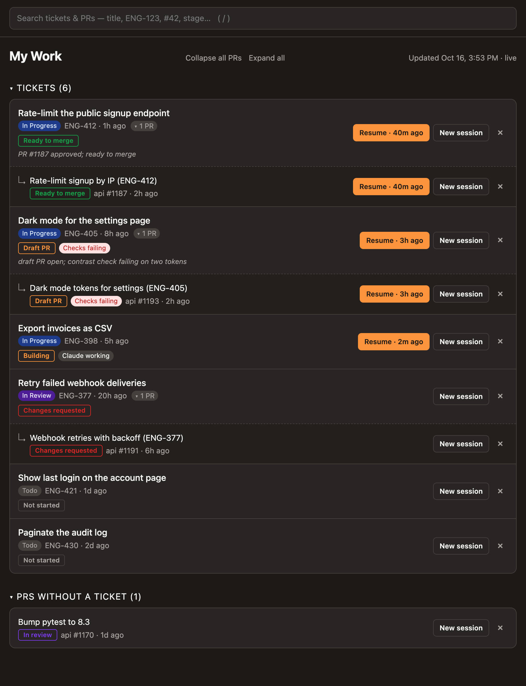

# Ticket to Agent Session Manager

Just a simple personal dashboard of my Linear tickets and GitHub PRs, with one-click Claude Code sessions.



## Setup

Needs macOS, the [Claude desktop app](https://claude.ai/download), Python 3.10+ and the [GitHub CLI](https://cli.github.com) (`gh auth login`). No other dependencies.

```bash
cp .env.example .env
python3 dashboard.py --serve
```

Fill in `.env` with a [Linear](https://linear.app/settings/account/security) personal API key and the repos to show. Open http://localhost:7777.

To keep it running in the background (starts at login):

```bash
scripts/install-service.sh
```

## How it works

- **Tickets**: your Linear tickets in Todo / In Progress / In Review, with their open PRs nested underneath.
- **Stage**: worked out from GitHub and Linear (Draft PR, In review, Changes requested, Ready to merge, …). Hover a stage to see why.
- **New session**: opens a Claude Code session in the right repo with `See ticket ENG-123`.
- **Resume**: reopens the most recent session that mentions the ticket or PR (by branch, first message or session title).
- **Spec**: a ticket counts as specced once it has a Linear document titled `Spec — …`.
